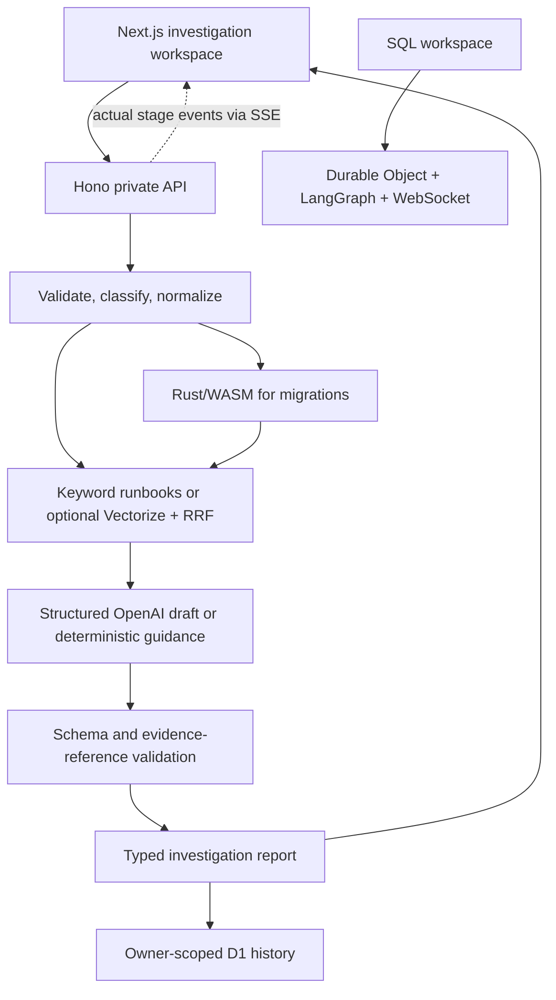

# Lockstep

**AI debugging and incident investigation**

Understand the error. Find the cause. Know what to do next.

Lockstep turns failure excerpts into structured investigations: deterministic observations,
working hypotheses, traceable evidence, remediation, verification, and missing context.
It preserves the original PostgreSQL migration analyzer as a specialized workspace.

## Supported inputs

- Python, JavaScript/TypeScript, and Java exceptions; representative Rust panics.
- Pytest, Jest/Vitest, assertion mismatches, and recognizable CI excerpts.
- HTTP 400, 401, 403, 404, 429, 500; JSON responses and common connectivity failures.
- Plain, timestamped, JSON, and newline-delimited JSON application logs.
- PostgreSQL errors, constraint violations, and schema failures.
- PostgreSQL migrations, parsed by the retained Rust/WASM analyzer.

These are signature-based parsers, not complete language or log-format implementations.
Unknown input remains inspectable and produces explicit warnings. Submitted code, SQL,
and shell commands are never executed.

## Run locally

Requirements: Node.js 24+, pnpm 11.9.0, and Rust for analyzer development.

```sh
pnpm install --frozen-lockfile
pnpm dev:worker
```

In another terminal:

```sh
pnpm dev:web
```

Open `http://localhost:3000`. Wrangler serves the backend on port 8787 with local D1
and Durable Objects. The schema is initialized on first use. No cloud credentials or
model key are required for deterministic analysis.

On Windows PowerShell with script execution disabled, use `pnpm.cmd` instead of `pnpm`.
Both dev processes are foreground processes that can be stopped with Ctrl+C.

The web app defaults to the local backend. To change it, copy
`apps/web/.env.example` to `apps/web/.env.local` and set `NEXT_PUBLIC_WORKER_URL`.
This is a public backend origin, never a provider credential.

For AI reports, copy `apps/worker/.dev.vars.example` to `.dev.vars` in that directory
and set `OPENAI_API_KEY`. `OPENAI_MODEL` optionally changes the default `gpt-4.1-mini`.
Live OpenAI calls send relevant input evidence and optional context to the provider.
Without a key, or when a provider response is unavailable, refused, malformed, or
contains invalid evidence references, the UI clearly labels deterministic analysis.

## Workspaces

- `/`: product introduction and direct links into implemented examples.
- `/investigate`: category selection, original failure input, description, environment,
  streamed pipeline stages, cancellation, reports, and JSON export.
- `/history`: persisted investigations, report reopening, and deletion.
- `/how-it-works`: evidence and workflow explanation.
- `/sql`: retained SQL editor, deterministic hazards, LangGraph review, WebSocket
  progress, rollout guidance, source references, and trace timings.

Reports separate observations from hypotheses. Citation validation checks source
identity and rejects missing references; it does not prove that an inferred cause
is true. Confidence is qualitative, and deterministic reports remain low confidence.

## Architecture



`packages/shared` owns versioned contracts, runtime validation, deterministic parsing,
source provenance, and report guards. Worker modules separate query construction,
retrieval, model calls, validation, guidance, orchestration, and persistence. The new
workflow uses modular typed stages; the specialized SQL workflow retains LangGraph
and LangChain where already useful.

New investigations use bundled keyword retrieval by default. Optional Vectorize
fuses keyword and OpenAI embedding rankings using Reciprocal Rank Fusion. Keyword
fallback is explicitly identified and is not presented as semantic search. The retained
SQL graph also supports local hash ranking for offline evaluation; those hash vectors
are not production embeddings.

The web build uses webpack extension aliases so shared TypeScript modules with `.js`
import specifiers resolve consistently. Fonts use the system stack; builds do not fetch
Google Fonts.

## Privacy and limits

A random 256-bit browser capability authorizes private history. Only its SHA-256 digest
is stored on the server. Requests use bearer headers; SQL WebSockets carry the key in
an offered subprotocol, not a URL. Clearing site storage loses access to that browser's
history. This is capability-based access, not account login, SSO, or cross-device sync.
Anyone holding the capability can access its investigations. Use HTTPS outside localhost.

History is owner-filtered, capped at 100 investigations per capability, and marked
`no-store`. The backend records running, failed, cancelled, and completed states.
An interrupted client can reopen a completed report from History; it cannot resume a
partially generated AI response. Retrying starts a new investigation.

Input is limited to 32,768 UTF-16 code units and 65,536 UTF-8 payload bytes, with bounded
optional fields. Evidence and findings have explicit caps and warnings. D1 admission
limits allow 10 investigations per capability and 60 globally per minute. These are
application resource limits, not a substitute for deployment-level abuse protection.
Model calls, embeddings, retrieved results, output sizes, and stored report sizes are
bounded. Traces record stage names and durations, not submissions or provider errors.

Remove credentials and personal information before submitting. Evidence is persisted
in reports and can contain the submitted material. Logs and retrieved sources are
untrusted data; provider prompts prohibit embedded instructions, and model output
cannot replace trusted identity, observations, or evidence. There is no automatic fix
execution.

## Checks and evaluation

```sh
pnpm lint
pnpm format:check
pnpm typecheck
pnpm test
pnpm build
pnpm test:rust
pnpm eval:retrieval
pnpm eval:investigations
pnpm exec playwright install chromium
pnpm test:e2e
pnpm security:scan
pnpm audit --audit-level moderate
```

Playwright starts local frontend and backend processes. Tests cover real submissions,
private persistence, SQL review, keyboard interaction, responsive layouts, cancellation,
network failures, and invalid responses. See [verification](docs/verification.md) for
commands actually executed and their results, and [evaluation](eval/README.md) for
fixture design and measurement limitations.

`security:scan` examines reachable history, staged blobs, source files, and historical
filenames using Secretlint and high-signal repository rules. It is a useful release
check, not proof that no secret can exist. `release:audit` additionally validates the
initial 37-commit Toronto timestamp schedule; ordinary development does not require
rewriting that release history.

## Deploy

The repository is not preconfigured to use the original application's Cloudflare
resources. Provision your own D1 database and replace the placeholder ID in
`apps/worker/wrangler.toml`:

```sh
pnpm --filter @lockstep/worker exec wrangler d1 create lockstep-remastered
pnpm --filter @lockstep/worker exec wrangler d1 migrations apply lockstep-remastered --remote
pnpm --filter @lockstep/worker exec wrangler secret put OPENAI_API_KEY
pnpm --filter @lockstep/worker exec wrangler deploy
```

Set `ALLOWED_ORIGINS` to the deployed frontend origin. The Durable Object migration
is included. Deploy `apps/web` as a Next.js application and set
`NEXT_PUBLIC_WORKER_URL` to the new Worker origin before building.

For optional semantic retrieval, provision a 64-dimensional cosine Vectorize index,
export the bundled public runbooks using an OpenAI key in the shell environment, and
upload their vectors:

```sh
pnpm --filter @lockstep/worker exec wrangler vectorize create lockstep-remastered-runbooks --dimensions 64 --metric cosine --binding VECTORIZE --update-config
pnpm --filter @lockstep/worker vector:export
pnpm --filter @lockstep/worker exec wrangler vectorize upsert lockstep-remastered-runbooks --file runbook-vectors.ndjson
```

The export command does not read `.dev.vars`; set `OPENAI_API_KEY` in the invoking
environment. It refuses hash embeddings and will not overwrite an existing output
file. Keep the `VECTORIZE` binding and exported IDs aligned with the bundled corpus.
Redeploy the Worker after adding the binding so it becomes active remotely.
No remote deployment, paid provider call, or Cloudflare provisioning is performed
by the test suite.

## Limitations

No live model or production infrastructure was verified for this release. Provider
behavior is covered with controlled responses, and local Wrangler exercises actual
WASM, Durable Objects, and D1. The curated corpus is small; arbitrary errors may need
additional code, runtime context, documentation, and human judgment. SQL hazards are
recognized patterns rather than an exhaustive safety guarantee. Parser byte offsets
are translated for Unicode source provenance.

## License

MIT. The original project's license and useful SQL infrastructure are retained.
