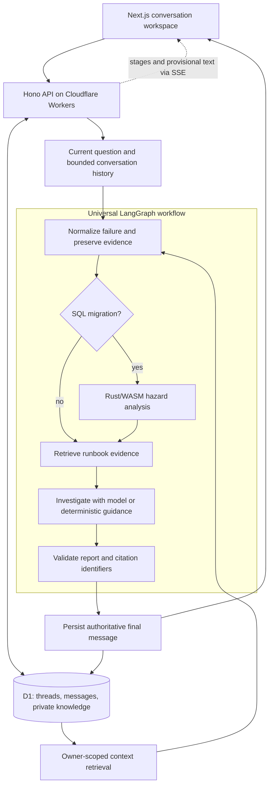

# Lockstep

**A debugging workspace that keeps the conversation, context, and evidence together.**

Lockstep helps investigate application errors, failed tests, HTTP failures, logs,
database errors, and PostgreSQL migrations. Paste a failure, add relevant code or
project notes, and ask follow-up questions in a persistent conversation. Each
investigation keeps its observations, possible causes, suggested fixes, verification
steps, and original sources available for inspection.

The backend combines deterministic parsers, retrieval, and optional model reasoning
in a universal LangGraph workflow. PostgreSQL migrations use a Rust/WebAssembly
specialist within that same workflow. The application also works without a model
key, with explicitly labelled deterministic guidance.

[Web app](https://lockstep-remastered.vercel.app) |
[API health](https://lockstep-remastered.mrkanwalsanat.workers.dev/health) |
[Deployment guide](docs/deployment.md)

## Architecture



All failure categories pass through a typed `StateGraph`. LangChain supplies the
retriever, documents, prompt template, and runnable retrieval sequence. Shared
TypeScript contracts validate requests, streamed events, messages, and reports.
Trusted observations and source identities remain separate from model-generated
hypotheses.

Keyword retrieval searches bundled runbooks and the owner's saved document chunks.
Optional Cloudflare Vectorize adds semantic ranking through provider embeddings;
private matches must resolve to existing, owned D1 chunks. When retrieval or model
requests fail, the workflow reports the fallback mode.

Streamed text is provisional. The final validated message replaces the draft and
is persisted before delivery. Turn identifiers, one active turn per thread, and
turn-specific cancellation protect against duplicate sends and late responses.
The retained SQL API also supports Durable Object sessions and WebSockets.

## Features

- **Ongoing investigations:** persistent threads, follow-up questions, recent
  conversations, private history, cancellation, and interrupted-turn recovery. Start
  with a greeting or a debugging question, then add a concrete failure when ready.
- **Project context:** paste or upload UTF-8 code, logs, documents, and notes. Pin
  sources to a conversation while other relevant library material remains searchable.
- **Inspectable answers:** source references, deterministic findings, alternative
  hypotheses, remediation, verification steps, and grouped log events when available.
- **Multiple failure categories:** representative Python, JavaScript/TypeScript,
  Java, Rust panic, test, HTTP, application-log, PostgreSQL, and SQLite signatures.
- **SQL analysis:** PostgreSQL migration parsing and recognized data-loss, lock-risk,
  and table-rewrite patterns through the checked-in Rust/WASM analyzer.
- **Usable delivery:** responsive conversation layout, keyboard-accessible drawers,
  copyable Markdown/code blocks, and explicit loading, network, and fallback states.

`/` and `/investigate` open the workspace. `/sql` opens the same interface with the
migration category selected; `/history` lists conversations and `/how-it-works`
explains the workflow. Existing owned investigation reports appear in thread history.

### Stack

| Layer                       | Technology                                                           |
| --------------------------- | -------------------------------------------------------------------- |
| Frontend                    | Next.js 16, React 19, TypeScript, CSS                                |
| API and persistence         | Cloudflare Workers, Hono, D1, Durable Objects                        |
| Orchestration and retrieval | LangGraph, LangChain, keyword search, optional Vectorize             |
| Model integration           | Server-side OpenAI-compatible Chat Completions and embeddings        |
| SQL specialist              | Rust, sqlparser, wasm-bindgen, WebAssembly                           |
| Verification                | Node.js tests, local Wrangler integration, Playwright, Rust fixtures |

## Repository layout

```text
apps/web/             Next.js workspace, history, context, and evidence UI
apps/worker/          Hono APIs, LangGraph workflow, retrieval, D1 migrations
packages/shared/     Versioned contracts, validation, failure normalization
packages/sql_guard/  Rust classifier and checked-in WebAssembly bindings
eval/                Labelled investigation, SQL, and retrieval fixtures
e2e/                 Browser integration and responsive interaction tests
docs/                Deployment guide and verification notes
scripts/             WASM build and repository auditing tools
```

See the [Worker API guide](apps/worker/README.md) for endpoints and streaming
contracts, and the [SQL analyzer guide](packages/sql_guard/README.md) for rebuilds.

## Run locally

Install **Node.js 24+** and **pnpm 11.9.0**. Rust is needed only to develop or rebuild
the SQL analyzer; its generated WebAssembly is already included.

From the repository root:

```sh
pnpm install --frozen-lockfile
pnpm dev:worker
```

In a second terminal, from the same root:

```sh
pnpm dev:web
```

Open **http://localhost:3000**. The backend runs at **http://localhost:8787** with
local D1 and Durable Objects; tables initialize on first use. No cloud provisioning
or model key is required for this local deterministic mode. Stop either process
with Ctrl+C. If PowerShell blocks scripts, use `pnpm.cmd` in place of `pnpm`.

To use a different backend, create `apps/web/.env.local` from `apps/web/.env.example`
only if missing, then set `NEXT_PUBLIC_WORKER_URL` to the backend URL. Restart the
frontend after local changes; hosted deployments require a rebuild.

## Enable OpenAI responses locally

1. Create an application API key using the [official OpenAI quickstart](https://developers.openai.com/api/docs/quickstart#create-and-export-an-api-key).
2. Create `apps/worker/.dev.vars` from `apps/worker/.dev.vars.example` **only if it
   does not exist**. Otherwise, edit the existing file and preserve its other settings.
3. Set `OPENAI_API_KEY` in that ignored Worker file. The optional settings below
   show the application's defaults; choose a model your project can access.

   ```dotenv
   OPENAI_API_KEY=replace-with-your-api-key
   OPENAI_MODEL=gpt-4.1-mini
   OPENAI_BASE_URL=https://api.openai.com/v1
   OPENAI_EMBEDDING_MODEL=text-embedding-3-small
   ```

4. Restart `pnpm dev:worker` and submit a non-sensitive sample in the browser.
   **AI key present** reports configuration presence. A completed reply labelled **AI response**
   confirms an actual model request; failures can produce a labelled fallback.

Fallback responses include a safe reason when the provider rejects credentials,
reports exhausted API credit or a project limit, rate-limits the request, or returns
an invalid response. Key presence does not prove available API credit. Check the
API account's billing and limits for quota errors; repeated retries do not restore
credit. Provider error bodies and credential values are never included in these
explanations. See [OpenAI error codes](https://developers.openai.com/api/docs/guides/error-codes).

Keep the key on the server, as required by [OpenAI's authentication guidance](https://developers.openai.com/api/reference/overview#authentication).
Real `.dev.vars` and `.env.local` files are ignored; their tracked `.example`
counterparts are public templates. `NEXT_PUBLIC_WORKER_URL` contains only a URL.

Compatible providers must support the application's Chat Completions and structured
JSON response contract. Optional semantic retrieval also needs 64-dimensional
embeddings. See the [deployment guide](docs/deployment.md) for production secrets,
provider configuration, and Vectorize setup.

## Tests and evaluation

```sh
pnpm lint
pnpm format:check
pnpm typecheck
pnpm test
pnpm build
pnpm test:rust
pnpm eval:investigations
pnpm eval:retrieval
pnpm exec playwright install chromium
pnpm test:e2e
pnpm security:scan
```

Tests exercise local Wrangler/D1/WASM, a controlled HTTP provider, and the browser.
Coverage includes follow-up memory, private retrieval, ownership, persistence,
idempotency, cancellation races, provisional/final replacement, and network failures.
The test suites do not require live provider credentials. Run retrieval evaluation
with provider credentials unset to reproduce its offline mode.

[Evaluation notes](eval/README.md) explain the labelled fixtures, metrics, and their
limits. [Verification notes](docs/verification.md) record executed checks and known
verification gaps. Local tests do not establish live model quality or successful
production deployment.

## Deployment

Deploy the Worker with a new D1 database, apply all migrations, and deploy `apps/web`
as a Next.js monorepo application. Set the frontend's `NEXT_PUBLIC_WORKER_URL` before
building, then allow that frontend's exact HTTPS origin through the Worker's
`ALLOWED_ORIGINS` setting. When deploying to another Cloudflare account, create a
D1 database and replace the deployment-specific database identifier. Resource IDs
and public origins are configuration, not authentication credentials.

The [deployment guide](docs/deployment.md) covers the complete Cloudflare/Vercel
sequence, CORS, production secrets, and smoke checks. The public app can use
deterministic mode before an API key or optional Vectorize index is configured.

## Privacy and limitations

A random browser capability controls access to that browser's data; the server
stores its SHA-256 digest. This is capability-based ownership with no account login
or cross-device sync. Clearing browser storage loses access to saved data. Use HTTPS
outside localhost and protect the capability as a credential.

Conversations and context are persisted. Relevant excerpts, recent messages, and
environment details can be sent to the configured model provider. Review inputs
for secrets before submission. Deleting a source prevents future retrieval, while
earlier saved answers can still contain its excerpts.

Inputs and storage are bounded: 100 threads per owner, 100 messages per thread,
50 library documents, and 12 pinned sources. Messages/documents allow 32,768 UTF-16
code units; uploaded files must be valid UTF-8 text/code within 32 KiB. PDFs, images,
archives, and binary files are unsupported.

Parsers recognize representative signatures, and the runbook corpus is limited.
Citation validation checks source identity, not proof of a diagnosis. SQL checks
recognize patterns without live schema or database state. Submitted code, SQL, and
shell commands are never executed. Review suggested changes and verify them in your
own environment. Persisted conversations are not resumable LangGraph checkpoints.

## License

[MIT](LICENSE).
