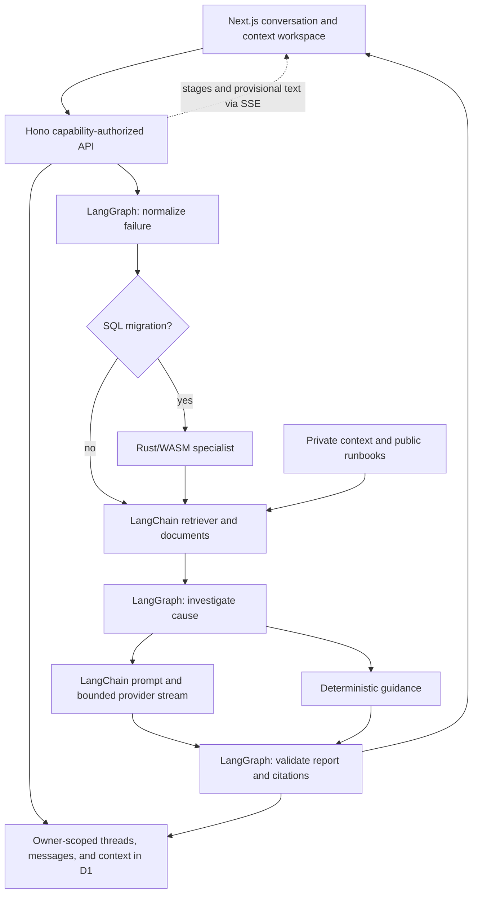

# Lockstep

**Your debugging sidekick, with the evidence attached.**

Give Lockstep an error, ask a follow-up, and bring the code, logs, or project notes it
needs. It keeps the conversation, retrieves relevant context, and explains what to
check next. SQL is one specialist in the same agent workspace.

## Try it locally

Requirements: Node.js 24+, pnpm 11.9.0, and Rust only for analyzer development.

```sh
pnpm install --frozen-lockfile
pnpm dev:worker
```

In another terminal:

```sh
pnpm dev:web
```

Open **http://localhost:3000**. The Worker runs at http://localhost:8787 using local
D1 and Durable Objects. Tables initialize on first use. On PowerShell with script
execution disabled, use `pnpm.cmd`. Stop either process with Ctrl+C.

No provider key is needed to explore the app: deterministic evidence and guidance
remain usable and are explicitly labeled. To enable model-generated responses,
configure the server as described below.

## What the sidekick does

- Persistent conversations, follow-up questions, recent threads, and private history.
- Paste or upload UTF-8 code, logs, documentation, and notes into a context library.
  Pin documents to a conversation; relevant library excerpts are also searched.
- Real pipeline progress and streamed model text, followed by a validated final
  response. Copy code and inspect the original sources, findings, and verification.
- Cancel an active turn, reopen saved conversations, and delete threads or context.
- Investigate Python, JavaScript/TypeScript, Java, Rust panics, test failures, HTTP
  errors, application logs, PostgreSQL/SQLite errors, and PostgreSQL migrations.
- Preserve Rust/WASM SQL hazard analysis inside the shared LangGraph workflow.

The original SQL editor has been replaced by the conversation interface. `/sql`
opens that same agent with SQL migration analysis selected. The existing SQL APIs,
Durable Object, WebSocket protocol, parser, and runbooks remain compatible.

`/` and `/investigate` open the sidekick, `/history` lists conversations, and
`/how-it-works` explains evidence and context. Existing completed
investigations are imported into conversations when their owner opens history.

Parsers recognize representative signatures rather than every language or format.
Unknown input stays inspectable. Code and commands are suggestions for you to
review; the application never executes submitted code, SQL, or shell commands.

## Enable OpenAI responses locally

1. Create an application API key in your OpenAI Platform project. The
   [official quickstart](https://developers.openai.com/api/docs/quickstart#create-and-export-an-api-key)
   links to the key dashboard. Use a model your project can access.
2. Create `apps/worker/.dev.vars` from the tracked template **only if it is missing**.
   Run one of the following from the repository root.

   PowerShell:

   ```powershell
   if (-not (Test-Path -LiteralPath 'apps/worker/.dev.vars')) {
     Copy-Item -LiteralPath 'apps/worker/.dev.vars.example' -Destination 'apps/worker/.dev.vars'
   }
   notepad apps/worker/.dev.vars
   ```

   macOS or Linux:

   ```sh
   if [ ! -e apps/worker/.dev.vars ]; then
     cp apps/worker/.dev.vars.example apps/worker/.dev.vars
   fi
   ```

   Open that file in your editor. If it already exists, edit its existing settings;
   do not replace it with the template.

3. Set the key in this ignored, server-only file:

   ```dotenv
   OPENAI_API_KEY=replace-with-your-api-key
   ```

   The tracked `.dev.vars.example` stays a placeholder template. Do not put a real
   key in it, in browser storage, or in any `NEXT_PUBLIC_` variable. OpenAI's
   [authentication guidance](https://developers.openai.com/api/reference/overview#authentication)
   requires keeping secret keys on the server.

4. Stop the Worker with Ctrl+C, then restart it:

   ```sh
   pnpm dev:worker
   ```

   On PowerShell with script execution disabled, use `pnpm.cmd dev:worker`.

5. Open http://localhost:3000 and submit a non-sensitive example. **AI configured**
   means the Worker found configuration; it does not prove the key, model access,
   or provider request succeeded. A completed **AI investigation** response is the
   live integration check. A deterministic response remains clearly labelled if
   the provider is unavailable or the result fails validation.

The application already has defaults for these optional server settings. Override
only the values you need in `apps/worker/.dev.vars`:

```dotenv
OPENAI_MODEL=gpt-4.1-mini
OPENAI_BASE_URL=https://api.openai.com/v1
OPENAI_EMBEDDING_MODEL=text-embedding-3-small
```

These are the checked-in application defaults, not a claim that every account or
compatible service supports those models. Restart the Worker after changing them.
The settings apply consistently to conversations, investigations, retained SQL review,
and embeddings. No frontend key configuration is required.

For a custom OpenAI-compatible service, use its API root in `OPENAI_BASE_URL` and
its supported model name. HTTPS is required except for loopback development servers.
The endpoint must support `/chat/completions`, structured JSON responses, and either
SSE streaming or a complete JSON response. Optional semantic retrieval also needs
`/embeddings` with 64-dimensional output. Unsupported schemas, refusals, timeouts,
and invalid citations fall back to deterministic guidance when possible.

Model calls include relevant error evidence, retrieved context, environment details,
and a bounded conversation window. Streamed text is provisional until validation;
the final saved message replaces the draft if fallback is necessary. Citation checks
verify source identifiers, not whether an inferred explanation is true.

To change the backend origin, create `apps/web/.env.local` from `apps/web/.env.example`
if it is missing and set `NEXT_PUBLIC_WORKER_URL`. This public setting contains only
the backend URL. Restart the frontend after changing it locally; hosted builds need
to be rebuilt. Keep the real `.dev.vars` and `.env.local` files private. Their tracked
`.example` counterparts contain reusable public configuration templates.

## Architecture



All investigation categories use an actual `StateGraph`, with a conditional SQL
node. LangChain supplies the retriever, documents, prompt template, and runnable
retrieval sequence. Shared versioned contracts validate inputs, events, stored
messages, reports, and source provenance. Final reports preserve trusted identity,
observations, and evidence independently of model output.

The default retrieval path searches bundled runbooks and private D1 document chunks
by keyword. Optional Cloudflare Vectorize uses provider embeddings and owner-filtered
namespaces for private context. Retrieved vector matches must resolve to owned,
existing D1 chunks. Keyword fallback remains available when indexing fails. The old
SQL retrieval evaluation uses local hash vectors only for offline regression checks;
those are not production semantic embeddings.

Next.js uses webpack extension aliases for the shared TypeScript imports. Builds use
system fonts and do not fetch Google Fonts.

## Storage, privacy, and bounds

A random 256-bit browser capability grants access to that browser's data. The server
stores its SHA-256 digest. Bearer headers carry the capability; retained SQL WebSockets
use a subprotocol rather than a URL parameter. Clearing site storage loses access.
This provides private browser ownership, without account login or cross-device sync.
Use HTTPS outside localhost and treat the capability like a password.

Conversation limits are 100 threads per owner, 100 messages per thread, and 4 MiB of
stored thread data. Model memory uses at most 10 recent messages and 24,000 characters,
plus the selected failure and retrieved evidence. Turn IDs prevent duplicate sends;
leases and turn-specific cancellation keep interrupted work recoverable. Partial
model output is not a resumable LangGraph checkpoint. Retry starts another turn.

The library accepts up to 50 documents per owner, each at most 32,768 UTF-16 code
units. The frontend accepts text/code files up to 32 KiB with valid UTF-8; PDFs,
images, archives, and binary files are unsupported. Pin up to 12 documents; their
first 1,200 characters receive priority, while relevance search can retrieve up to
8 chunks and 16,000 characters from the library. Deleting a document removes it from
future retrieval; earlier saved answers can still contain its cited excerpts.

Messages allow 32,768 code units and request bodies are capped at 65,536 UTF-8 bytes.
Admission limits allow 10 analysis/upload requests per owner and 60 globally per
minute. Provider calls, retrieved evidence, output sizes, and stored reports are
bounded. Traces contain stage names and timings, not raw inputs or credentials.

Review material for credentials before submitting. Conversations and context are
persisted and relevant excerpts can be sent to the configured provider. Retrieved
text is treated as untrusted data. No automatic command execution is implemented.

## Checks and evaluation

```sh
pnpm lint
pnpm format:check
pnpm typecheck
pnpm test
pnpm build
pnpm test:rust
pnpm eval:retrieval
pnpm eval:investigations
pnpm exec playwright install chromium
pnpm test:e2e
pnpm security:scan
pnpm audit --audit-level moderate
```

Tests exercise real local Wrangler/D1/WASM and a controlled HTTP provider, including
multi-turn memory, private retrieval, streaming, invalid citations, cancellation,
idempotency, ownership, history migration, responsive layouts, and network failures.
They never require a live provider key. See [verification](docs/verification.md) for
executed results and [evaluation](eval/README.md) for measurement limitations.

The repository scanner examines reachable history, staged blobs, current source,
and historical filenames using Secretlint and additional rules. `release:audit`
also validates 40 ordered release commits with distinct file trees and chronological
November 1-2 timestamps after repository creation. The application changes and their
implementation order are preserved. Binary strings are scanned as well as source
text. Historical binary build-path metadata is reported separately; see the
verification document for the inherited artifact limitation.

## Deployment

Use a new Cloudflare D1 database and Worker for the backend, then deploy `apps/web`
as a Next.js app with the Worker URL. Configure the frontend origin on the Worker
and store the provider key as a Worker secret. The checked-in D1 ID is a placeholder.

[The deployment guide](docs/deployment.md) covers backend provisioning, frontend
settings, optional Vectorize setup, and the smoke checks required after deployment.

## Limitations

Live OpenAI, embeddings, Vectorize, and production hosting require configured
accounts and separate verification. Controlled-provider tests establish local
integration behavior, not live diagnostic quality. The bundled corpus is small;
unfamiliar issues may need more context and human judgment. SQL hazards are pattern
checks rather than an exhaustive safety guarantee.

## License

MIT. The original license and useful SQL infrastructure are retained.
